

<!-- _class: lead -->
<!-- Cover: CPU weekly session 03, presenter Siyuan He (Robert), 6 November 2026 -->

# GitHub Beyond the Code

## From a Fork to Your First Merged PR

Siyuan He (Robert)

Computer Psycho Union · 6 November 2026

### WEEKLY 03

#### CPU 2026/27

---

<!-- _class: agenda -->
<!-- Agenda: five items, first row auto-highlighted -->

## What we will cover

1. Record a problem *Issues*
2. Fork & branch *copy it home, one change per branch*
3. Give it back *Pull Request — today's hero*
4. Robot checks *Actions*
5. Ship it as a website *Pages*

---

<!-- _class: side -->

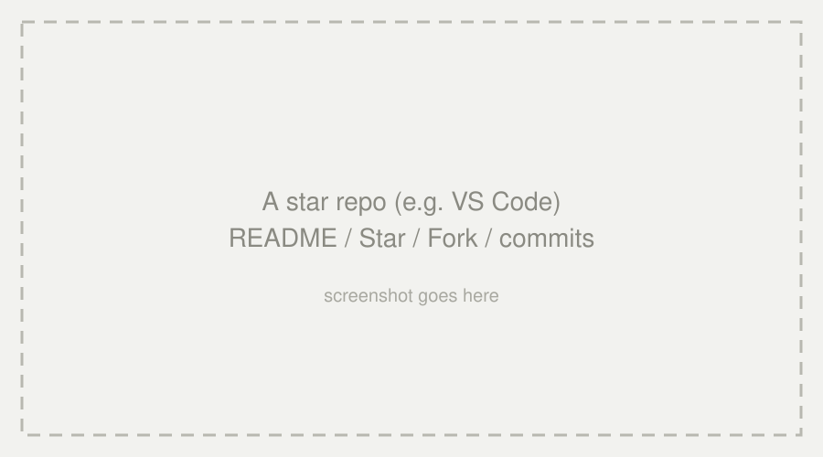

## 01 · More than code storage

### YOUR PROFILE

- Avatar
- Pinned repos
- Green squares

 

### STRANGERS, ONE CODEBASE

**2627-weekly-session** | **microsoft/vscode**

---

<!-- Regular content page: landscape placeholder below the text -->

## 02 · Today's question

- **You don't know the repo owner** — how do you safely hand your change back?
- No direct push, no trust — and yet the world ships this way every day

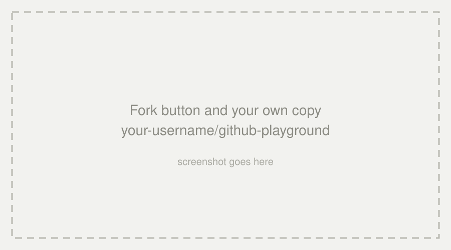

---

<!-- _class: side -->

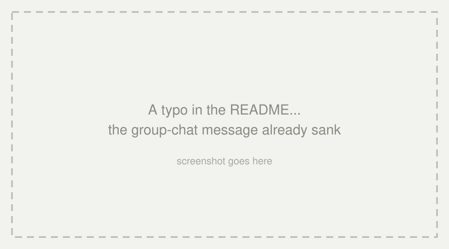

## 03 · Problem: the typo that drowned

### WHAT HAPPENED

You spot a typo in a project README. You mention it in the group chat

 

### THE QUESTION

Where should small problems live, so they don't get lost?

---

<!-- _class: side -->

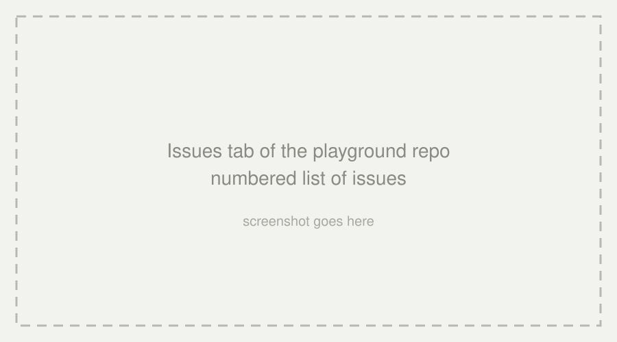

## 04 · Issues

### A SHARED TODO

A typo in the README, a feature wish — too small for a PR, too easy to lose in a chat group.

 

### NUMBERED & PUBLIC

- A number
- label, assignee, milestone

---

<!-- _class: side -->

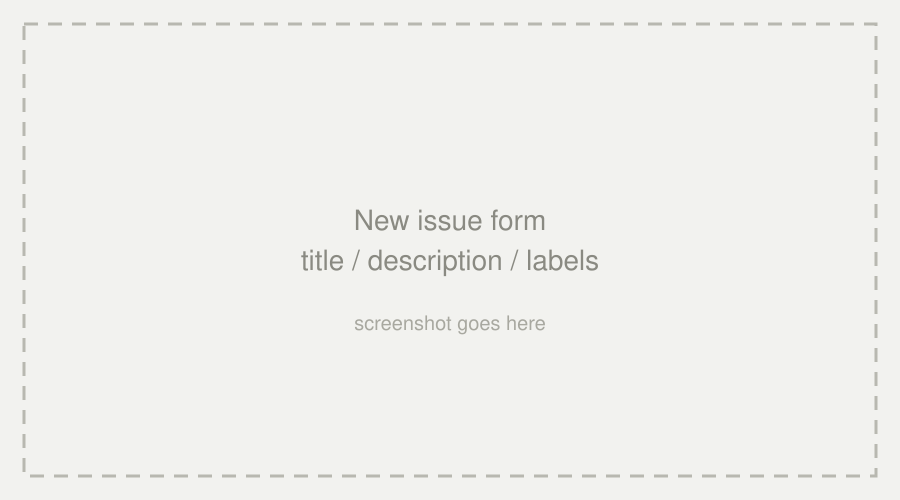

## 05 · Create an Issue

### YOUR TURN

Open a new issue on the playground repo — propose an improvement, two or three lines, a clear title.

 

### REMEMBER THE NUMBER

`Fixes #N` later links your PR to this issue.

#### #N

---

<!-- _class: side -->

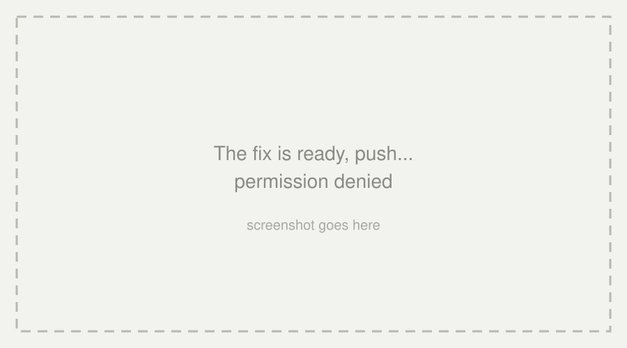

## 06 · Problem: push denied

### WHAT HAPPENED

The fix is ready, you hit push — `permission denied`. Of course: the repository is not yours, and that is a feature, not a bug.

 

### THE QUESTION

How do you get your own copy to work on?

#### DENIED

---

<!-- _class: side -->

## 07 · Fork: copy it home

### NOT YOUR REPO

You cannot push to someone else's repository — that is a feature, not a bug.

 

### YOUR OWN COPY

Fork duplicates the whole repo under your account; break it freely, upstream stays untouched.

#### FORK

---

<!-- _class: side -->

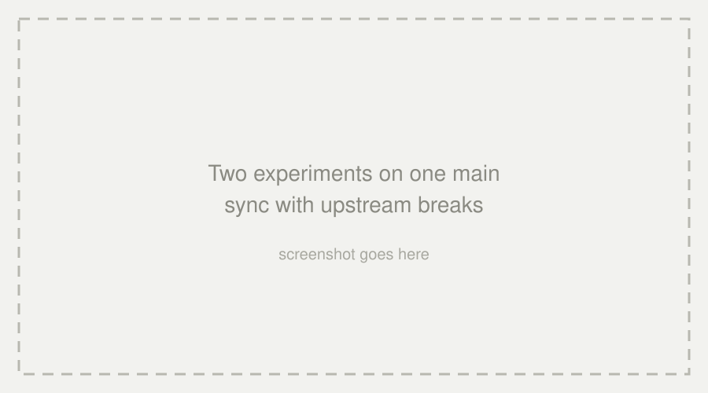

## 08 · Problem: one main, two experiments

### WHAT HAPPENED

The lazy path is editing main directly — until your half-finished idea, your typo fix, and the upstream sync all tangle on the same line of history.

 

### THE QUESTION

How do we keep every change in its own lane?

---

<!-- _class: side -->

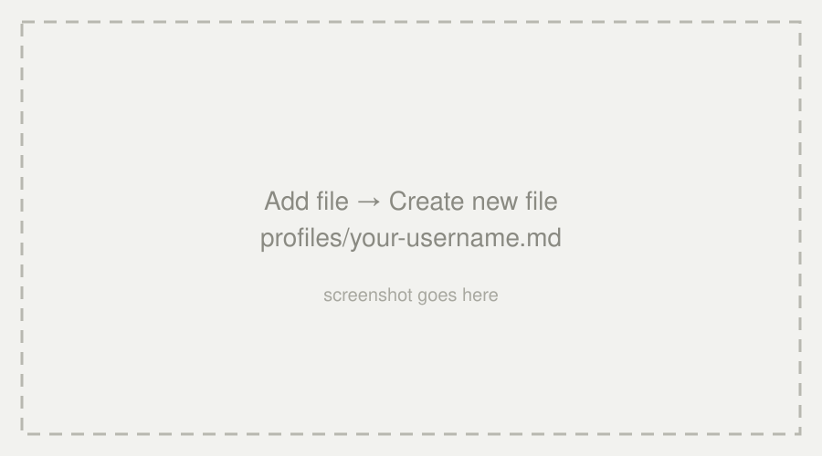

## 09 · Branch first, then edit

### WHY NOT MAIN?

Main stays in sync with upstream; one change per branch — `docs/add-<your-username>`.

 

### HANDS-ON

`profiles/` → **Add file → Create new file** → `<your-username>.md` → commit on a new branch.

---

<!-- _class: side -->

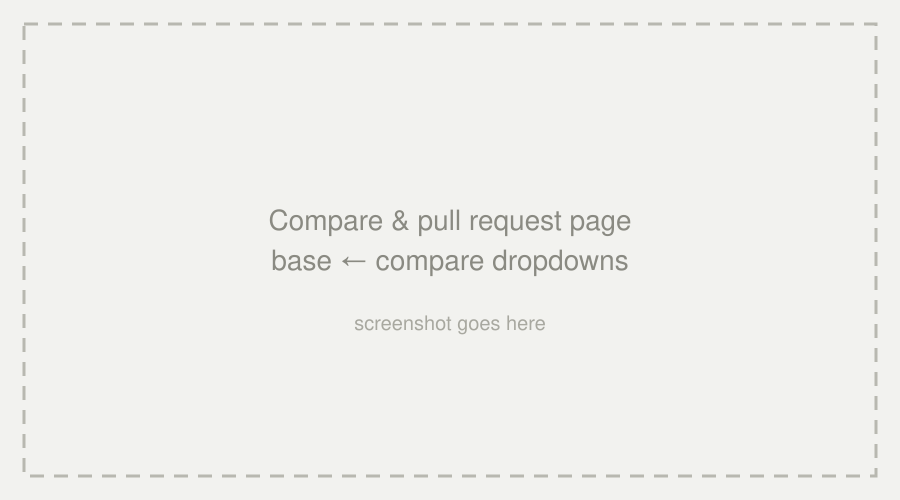

## 10 · Pull Request: the letter

### COMPARE & PULL REQUEST

GitHub notices your branch is ahead and offers to propose the merge.

 

### READ THE DIRECTION

base ← upstream `main` · compare ← your fork's branch.

#### PR

---

<!-- _class: side -->

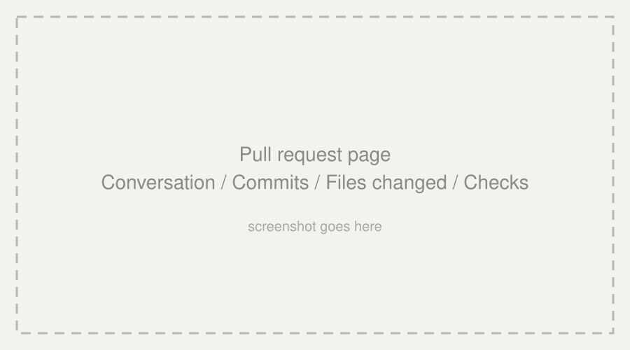

## 11 · Anatomy of a pull request

### TABS

**Conversation** — the whole story
**Commits** — the saves
**Files changed** — line-by-line diff
**Checks** — **Actions** done by bots.

 

### NOT A COMMAND

A PR is a request for review.

---

<!-- _class: side -->

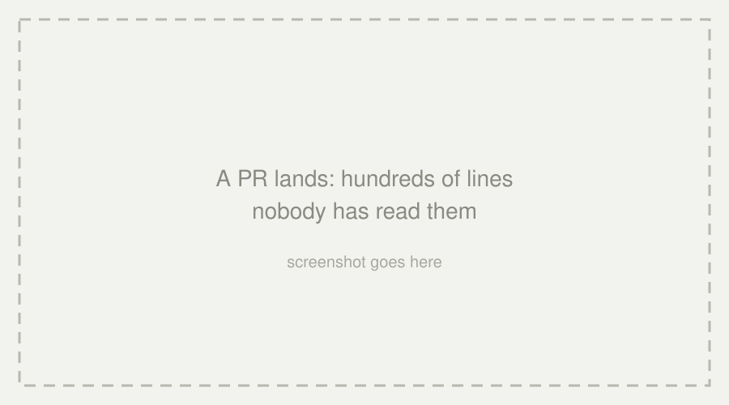

## 12 · Problem: a wall of lines

### WHAT HAPPENED

Your PR arrives — hundreds of changed lines from a stranger. The maintainer has thirty more like it today.

 

### THE QUESTION

How can anyone trust code they did not write?

---

<!-- _class: side -->

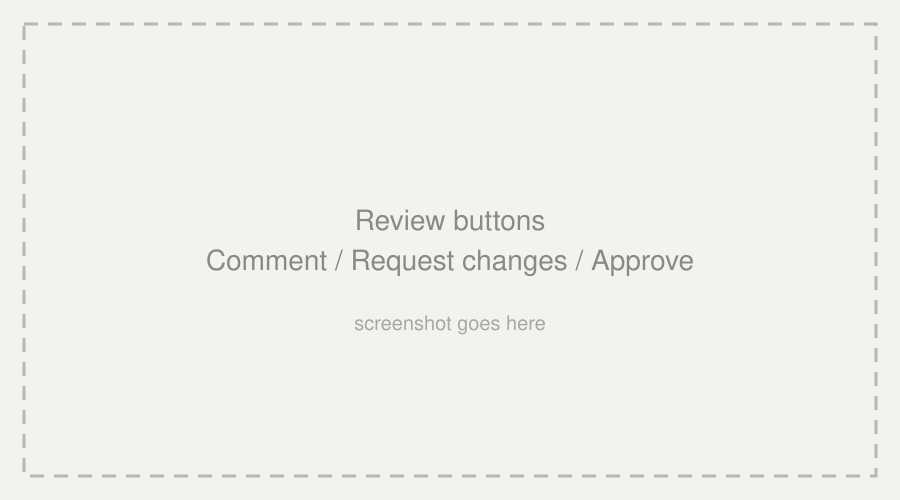

## 13 · Review

### ON STAGE

Live demo: pick one PR, comment on a line, **Approve**.

 

### THE CULTURE

Review the code, not the person; describe what and why.

#### RESPECT

---

<!-- _class: side -->

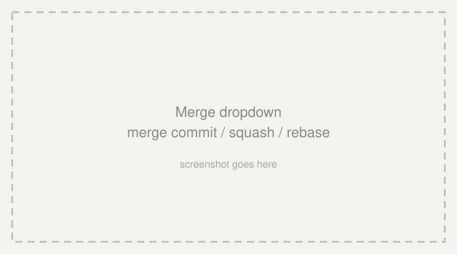

## 14 · Merge: three shapes of history

### PICK ONE

**Merge commit** — keep everything · **Squash** — compress to one · **Rebase** — replay in a line.

 

### IN THIS REPO

Nobody clicks — the robot squash-merges every PR that passes the checks.

---

<!-- _class: side -->

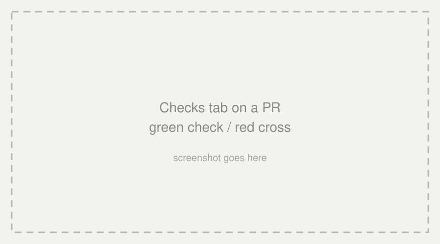

## 15 · Fixes #N — the loop closes

### THE CLIMAX

A PR whose description says `Fixes #N` closes issue #N the moment it merges.

 

### FULL TRACE

Problem → issue → fix → PR → merge → closed. That is open source.

#### CLOSED

---

<!-- _class: side -->

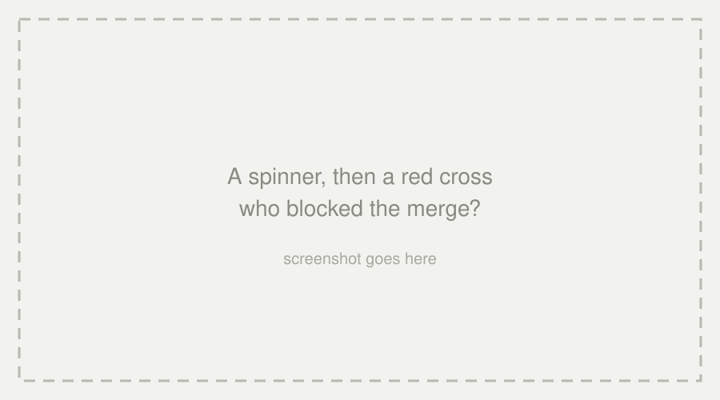

## 16 · The mystery stamp?

### WHAT HAPPENED

You open the PR page — a spinner spins, then a green tick or a red cross appears. Nobody clicked anything; the merge is blocked.

 

### THE QUESTION

Who — or what — is checking the code?

---

<!-- _class: side -->

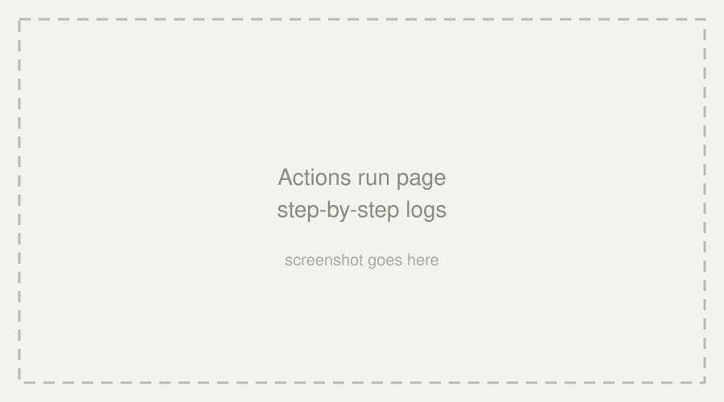

## 17 · Actions: bot colleague

### CHECKS EXPLAINED

Every green tick is a workflow we wrote: one file, your username, content rules.

 

### WATCH IT WORK

Open the Actions tab in your fork — step-by-step logs.

#### CI

---

<!-- _class: side -->

## 18 · Red cross is a safety net

### CAUGHT IN THE ACT

Wrong filename, someone else's name, an extra file — the robot blocks the merge.

 

### NOT PUNISHMENT

The robot stops problems before they reach main.

#### GUARD

---

<!-- _class: side -->

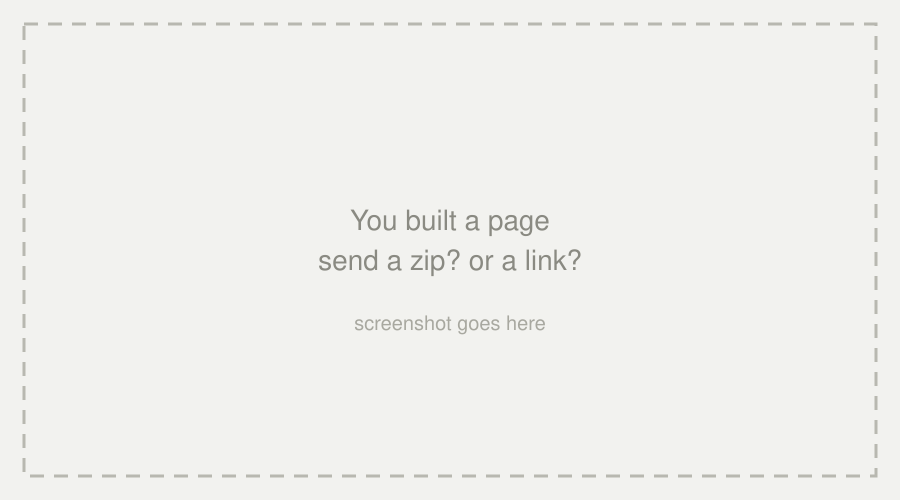

## 19 · Site written, host it?

### WHAT HAPPENED

The page works on your machine. Sharing it means sending a zip — or worse, "just clone my repo".

 

### THE QUESTION

How does a repository become a plain link?

#### SHARE

---

<!-- _class: side -->

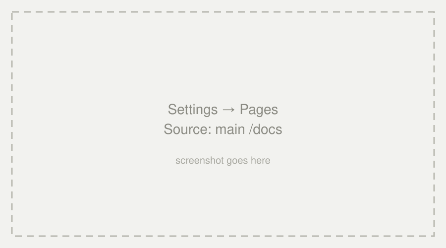

## 20 · Pages: repo becomes a website

### FREE HOSTING

Settings → Pages → Deploy from a branch → `main` / `/docs`.

 

### UPSTREAM vs FORK

Upstream deploys automatically via Actions; in your fork, you flip the switch once.

---

<!-- _class: side -->

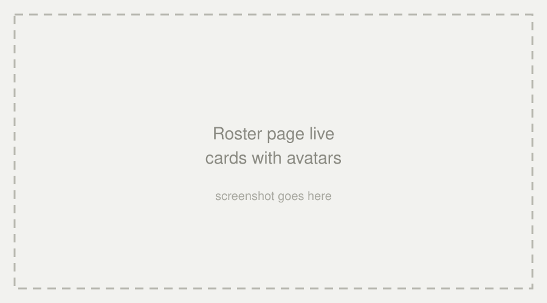

## 21 · The roster page

### ONE CARD PER PROFILE

Avatars straight from `github.com/<username>.png` — rebuilt by CI on every merge.

 

### VISIT EACH OTHER

Post your `username.github.io/github-playground` link in the group.

---

<!-- Regular content page -->

## 22 · Final exercise: connect the dots

- New branch → edit `docs/` → commit → **PR to your own repo**
- Checks run again → merge → the website updates itself

*Change → robot checks → deploy. You built the whole pipeline.*

---

<!-- _class: yellow -->
<!-- Closing page -->

## THANK YOU

### Q&A

#### Your Green Square Starts Today

Siyuan He (Robert) · Computer Psycho Union · 6 November 2026
