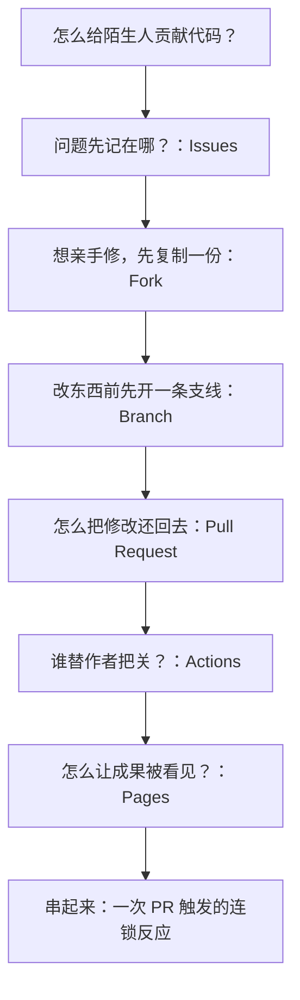

### 课前准备

准备一个 playground 仓库（如 `CompPsyUnion/github-playground`），预置：

- `README.md`（门面）；课堂练习是每人往 `profiles/` 目录新增一个 `<自己的 GitHub 用户名>.md` 文件（互不冲突）。
- 一个自制 CI workflow：**检测 `profiles/` 目录**——校验每人恰好一个以自己用户名命名的文件、内容非空等——让每个 PR 自动出现 Checks 绿勾/红叉。
- Pages 已配好一套漂亮的主题模板（`docs/` 或主题分支）——开启后立刻是一个好看的站点，而不是白纸。
- Settings：允许 fork、Issues 开放、Actions 对 fork 可见；**Pages 的 Build and deployment 选 "GitHub Actions"**（一次性）——之后上游站点由 CI 在每次 merge 后自动部署，无需任何人手动发布。

---

# 一、课程框架

## 课程标题

**GitHub Beyond the Code: From a Fork to Your First Merged PR**

副标题：

*Fork · Branch · Issue · Pull Request · Actions · Pages*

## 课程定位

| 项目 | 设计 |
| --- | --- |
| 目标受众 | 任何会打字的同学；有无 Git 基础均可（全程浏览器） |
| 总时长 | 50 分钟，单场 |
| 核心目标 | 深度体验一次完整的 Pull Request 流程，并顺路点亮 Issue、Actions 与 Pages |
| 实践比例 | 约 50%：每个功能都现场亲手点一遍 |
| 教学方式 | playground 仓库驱动、需求故事、纯网页操作 |

## 学习目标

完成课程后，同学们应该能够：

1. 用浏览器完成 Fork → 建分支 → 编辑 → Commit → Pull Request 的完整链路，并说清 PR 的 base/compare 方向。
2. 提一个结构清晰的 Issue，并用 `Fixes #N` 让 PR 与 issue 联动、merge 时自动关闭。
3. 读懂 PR 页面的四个标签（Conversation / Commits / Files changed / Checks），并作为 reviewer 留下 Comment 与 Approve。
4. 解释 Actions 在 PR 上做了什么（机器人跑检查，绿勾/红叉），并能查看运行记录。
5. 为自己的仓库开启 GitHub Pages，拿到线上网址。
6. 说出 merge 的三种方式各自适合什么时候（一句话层面）。

---

# 二、课程内容（单场 50 分钟）

## Part 1 — 不止是存代码（0–5 min）

- GitHub = 代码的家 + 协作平台 + 你的技术主页（一句话带过主页与绿格子：格子越绿，提交越勤）。
- 现场开一个明星仓库（如 VS Code）扫一眼：README 是门面、右上角 Star/Fork、commits 里全是来自世界各地的人——**开源就是这样一群互不相识的人改同一份代码**。
- 抛出今天的问题：**你不认识仓库主人，怎么安全地把你的修改"给回去"？** 今天按一次真实贡献的时间顺序走：先学会把问题**记录**下来（Issues），再亲手**解决**它（Fork → Branch → Pull Request），路上还会遇到 Actions 和 Pages。

**GitHub 的核心魔法不是存代码，而是让陌生人安全地交换代码。**

## Part 2 — Issues：把问题写在代码旁边（5–12 min）

需求出现：还没动手改，问题本身先放在哪？"README 有个错字""希望 playground 加个相册页"——直接发 PR 太重，群里说一句会丢。

- **Issue** = 仓库的公开待办与讨论：标题 + 描述 + 评论，每条有唯一编号（如 `#3`）。
- 三个配件各一句话：**Label** 分类（`bug` / `proposal`）、**Assignees** 认领、**Milestone** 排期——本团队的 2627-weekly-session 仓库正是用 Milestone 给周常排期的。
- 现场演示：打开 VS Code 仓库的 Issues 标签——数千条编号讨论，开源项目的"需求池"就长这样。
- 每人动手：给上游 playground 提一个真实小 issue（提案式：希望增加/改进什么，两三行即可，用上清晰的标题）——**记住自己 issue 的编号，等会儿有用**。

**Issue 是团队的共享备忘录——写下来，别只活在群里。**

钩子：issue 写好了，怎么亲手解决它？——先把它抄回家。

## Part 3 — Fork 与 Branch：先复制，再开一条支线（12–19 min）

需求出现：不能直接改别人的仓库（不然任何人都能往 VS Code 塞代码）。

- **Fork** = 把整个仓库复制到自己账号下，变成“你的版本”，随便折腾不影响原仓库。

第二个需求出现：改之前为什么要**先建分支**，而不是直接改 fork 的 main？

- fork 的 **main** 要保持“和上游一致”，方便日后同步更新；
- 每个修改住自己的**分支**（如 `docs/add-<你的用户名>`）：一个分支一件事，互不干扰——以后同时开着两三个 PR 也不会串；
- 直接改 main 也能发 PR，但两个修改会挤在同一条线上，review 和回退都麻烦。

网页操作（两条路，演示第一条即可）：

- 路线一（新建文件）：文件列表页进入 `profiles/` 目录 → **Add file → Create new file** → 输入文件名 `<你的 GitHub 用户名>.md` → 写两三行自我介绍 → **Commit changes** 对话框里选 **"Create a new branch for this commit"**，填分支名（如 `add-<你的用户名>`）→ Commit——网页顺便就把分支建好了。
- 路线二：先在分支下拉框输入新分支名 → "Create branch from main" → 再进分支新建文件。

每个人动手：fork playground，从新分支在 `profiles/` 下**新建名为自己 GitHub 用户名的 `<用户名>.md`**（写两三行自我介绍），commit。每人一个独立文件——几十个人的 PR 互不冲突，还能逐个 review。

**Fork 是“先抄回家”，Branch 是“一件修改一条支线”，Commit 是“存档一次”。**

## Part 4 — Pull Request：把修改还给上游（19–33 min）——今天的主角

### 4.1 发起 PR

- 改完 commit 后，fork 页面会弹出黄色横幅 **"Compare & pull request"**——GitHub 在提醒你：你的分支领先了，要不要请上游合并？
- **看懂方向**（投屏指给大家）：打开的 Compare 页面有两个下拉——
  - **base**（左侧）：合并的目标——**上游仓库的目标分支**（这里选 `CompPsyUnion/github-playground` 的 `main`）；
  - **compare**（右侧）：改动来源——**你 fork 里的那条新分支**。
  - 读法：“请求把（compare）我的分支，合进（base）上游的 main”。方向反了 PR 就发错地方——GitHub 通常会自动填好，但要知道这两个框在说什么；仓库有多个目标分支（如 `dev`/`main`）时要自己选对 base。
- 填写：清晰的标题、两三行描述（改了什么/为什么）；**顺手在描述里写上 `Fixes #编号`**——指向你刚才在 Part 2 提的那个 issue。**Create pull request**。

### 4.2 PR 页面解剖（重点，慢慢走）

以现场一位同学的真实 PR 为例投屏：

- **Conversation**：时间线——描述、review、检查结果、merge 记录，一个 PR 的完整故事。
- **Commits**：这次 PR 包含哪几次存档（之后还能往同一分支继续 push，PR 自动跟进）。
- **Files changed**：逐行 diff——绿加红删，review 的主战场。
- **Checks**：机器人检查（Part 5 揭晓）。

### 4.3 Review：讲台演示

到上游仓库的 PR 列表，现场挑一位同学的 PR 投屏演示：

- 在 Files changed 里对某一行点 **+** 留一条 Comment（例如一个 emoji 或建议）。
- 顶部三种表态：**Comment**（随便聊聊）/ **Request changes**（得改）/ **Approve**（放行）。演示走一遍后 **Approve**。
- 被选中演示的同学同步在自己的 PR 页面看评论到达的整个过程（实时通知）。
- 文化一句话：**review 对代码不对人；PR 描述写清“改了什么、为什么”。**

### 4.4 Merge 的三种方式（各一句话）+ 回扣 Issue

- **Create a merge commit**：全部保留，历史里多一个"结点"。
- **Squash and merge**：把多次提交压成一个——小步开发、整洁入库。
- **Rebase and merge**：逐个摘过来，保持线性历史。
- 讲师现场把同学们的 PR 逐个 **Squash merge**——大家看着自己的第一个 PR 变成 "Merged" 紫色标签。
- **回扣 Part 2 的钩子（本节高潮）**：描述里写了 `Fixes #N` 的 PR，merge 的那一瞬间，对应 issue 自动跳成 **Closed**——投屏同时打开那个 issue 页面给大家看。问题从提出到关闭，全程有迹可循。

**PR 不是命令，是一封"请审阅"的信；merge 的方式决定历史的形状，`Fixes #N` 让问题有始有终。**

## Part 5 — Actions：机器人同事（33–39 min）

需求出现：刚才 PR 页面那个 Checks 标签是什么？为什么有的 PR 有绿勾、有的红叉？

- **GitHub Actions** = 仓库里的机器人：定义好"什么时候干什么"（触发事件 + 脚本），它就自动执行。
- 我们的 playground 预置了一个**自制 CI**：每次 PR 自动**检查 `profiles/` 目录**——你提交的文件是不是以你的用户名命名、内容是否非空——刚才每个 PR 的 Checks 里那个绿勾，就是它跑完的痕迹。规则是我们自己写的几行脚本，不是什么高深工具。
- 每人动手：进自己 fork → **Actions** 标签页 → 看到一条条运行记录 → 点开一条，看每一步日志（机器人也是一步步干活的）。
- 故意制造红叉（演示）：讲师对犯规的 PR（如文件名乱写/内容为空）展示红叉 ❌ 与报错日志——**红叉不是惩罚，是机器人提前拦住了问题**。
- 一句话边界：写 workflow（YAML）属于进阶，今天只当它的雇主，不当它的程序员。

**Actions 是 7×24 在岗的同事：你提 PR，它先帮你检查一遍。**

## Part 6 — Pages：仓库一键上线（39–46 min）

需求出现：写了个网页/文档，想让别人看个链接而不是整个仓库？

- **GitHub Pages** = 免费静态网站托管：把仓库的某个分支/目录发布成网址。
- playground 已配好一套现成的主题模板——开出来就是一个排版好看的站点。
- 对比讲一个细节（30 秒）：**上游**仓库的站点是 CI 用 Actions 自动部署的（merge 即更新）；**你的 fork** 里没人替你配置——所以要自己到 Settings 里开一次。同一个功能，两种启用方式。
- 每人动手（fork 里已预置主题页面）：
  1. 自己的 fork → **Settings → Pages**。
  2. Source 选 `main` 分支 + `/docs` 目录 → **Save**。
  3. 等 1–2 分钟，刷新出线网址：`https://<用户名>.github.io/github-playground/`。
- 现场互访：把网址发到群里，访问同桌的站点。
- 一句话延伸：主题模板换成自己的内容，就是免费的漂亮个人网站（简历/项目主页；Jekyll/静态框架都支持，课后玩）。

**Pages 让仓库从"给人看的代码"变成"给世界看的网站"。**

## Part 7 — 收官：把今天的功能串起来（46–50 min）

最终练习（5 分钟内完成的轻量闭环，把功能串成一条线）：

1. 在自己 fork 里**先建新分支**，再改 `docs/` 里的页面内容（主题里加一行自己的名字/一句话）→ commit。
2. 向**自己的仓库**发一个 PR（base 选自己仓库的 `main`，compare 选新分支——仓库内部的分支合并也是 PR）。
3. 观察：PR 的 Checks 里 Actions 又自动跑了一遍；merge 后 **Pages 网站自动更新**——改了网站，机器人先检查，检查过了自动上线。
4. 讲师现场指向上游：你们的 PR（每人 `profiles/` 一个 `<用户名>.md`）已经全部 merge、关联的 issue 已自动关闭——刷新个人主页，今天的绿格子亮了。

收尾四问：

1. Fork 改完之后，怎么让原作者看到？（Pull Request）
2. 问题/建议先写在哪里？（Issues，`Fixes #N` 联动）
3. PR 页面的绿叉/红叉是谁打的？（Actions 机器人）
4. 怎么把仓库变成一个能访问的网站？（Pages）

> **一句话收束：Fork 给你自由，Branch 划清边界，Issue 说清需求，PR 建立信任，Actions 守住质量，Pages 面向世界——这就是在 GitHub 上创造的六步。**

---

# 三、刻意避开

| 内容 | 处理 |
| --- | --- |
| Actions workflow 编写（YAML） | 只消费不生产，课后兴趣引导 |
| 网页冲突解决 / rebase 实操 | 只在有人 PR 报冲突时现场指认现象 |
| Jekyll 主题定制 / 自定义域名 | Pages 只到"拿到网址"为止 |
| GitHub API / 组织权限实操 | 不讲（全景表里认个脸即可） |
| 本地 Git / VSCode 流程 | 本场纯浏览器；已在 S02 覆盖 |
| 下表全景功能的任何展开 | 陈列一句话，课后按图索骥 |

# 四、功能全景：今天没玩到的（陈列即可，每项一句话）

结课前一页快闪，让同学知道 GitHub 还有什么、什么时候回来找它：

| 功能 | 一句话 | 什么时候需要它 |
| --- | --- | --- |
| Discussions | 仓库自带的论坛（问答/公告） | 问题不适合当成待办时 |
| Projects | 看板式排期，issue/PR 拖成卡片 | 团队多任务并行 |
| Wiki | 仓库自带文档站 | 长文档塞不下 README |
| Releases / Tags | 正式发版、挂下载包 | 项目要对外发布版本 |
| Gists | 单文件代码片段分享 | 临时贴一段代码给别人 |
| Insights | 贡献统计、社区健康度 | 判断一个项目活不活跃 |
| Dependabot / Security | 依赖漏洞自动报警 | 项目用了第三方库 |
| Codespaces / github.dev | 云端开发环境；任意仓库按 `.` 秒开网页版编辑器 | 不想配本地环境 |
| Copilot | AI 结对程序员（学生包免费） | 写代码的时候 |
| GitHub CLI（gh） | 命令行操作 PR/issue | 熟悉终端之后 |
| Mobile App | 手机上 review/merge | 通勤处理通知 |
| Sponsors | 赞助开源作者 | 想支持喜欢的维护者 |
| Organizations / Teams | 组织级账号与权限管理 | 团队/社团共用仓库 |
| Branch protection | 规定谁能直接 push、PR 须几人 approve | 项目要立规矩 |

# 六、最终时间表

| 时间 | 模块 | 核心内容 |
| --- | --- | --- |
| 0–5 min | 不止是存代码 | 明星仓库漫游；今天的问题：怎么给陌生人贡献代码 |
| 5–12 min | Issues | 提一个真实 issue；Label/Assignee/Milestone 一句话 |
| 12–19 min | Fork & Branch | 复制到自己家；改前先建分支；网页在 `profiles/` 新建 `<用户名>.md` 并 commit |
| 19–33 min | Pull Request（主角） | 发起 PR 与 base/compare 方向、`Fixes #N`；四标签解剖；讲台演示 review；merge 三式与 issue 自动关闭 |
| 33–39 min | Actions | PR 上的 Checks；运行日志；红叉演示 |
| 39–46 min | Pages | Settings → Pages；拿到线上网址；互访 |
| 46–50 min | 收官串联 + 全景一瞥 | 改页面 → PR 自己 → Checks → merge → 网站自动更新；功能全景一页快闪 |

# 七、叙事故事线

**核心教学原则：一条 PR 主线贯穿全场，每个功能都因为"这条主线需要它"而出现，并且每人亲手点一遍。**
