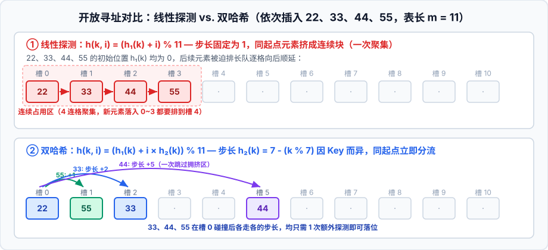
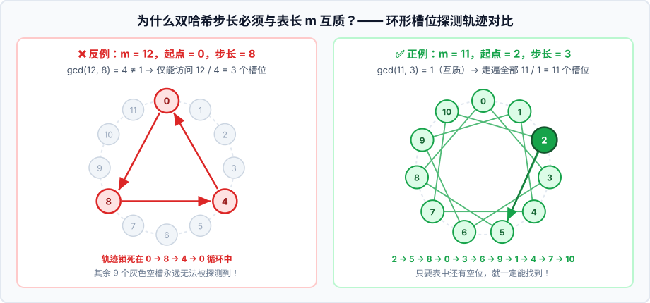
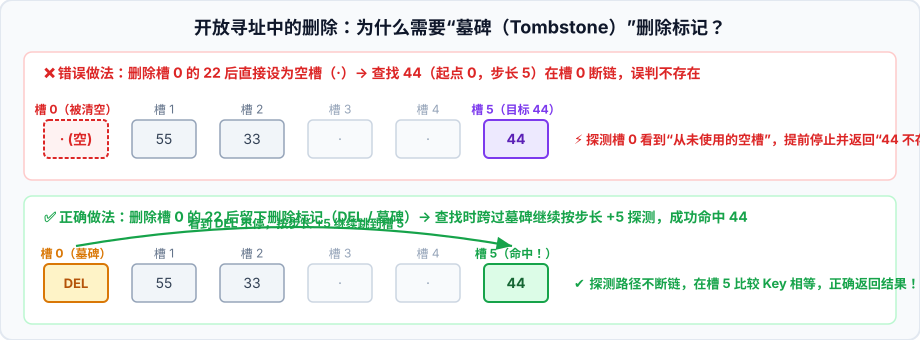

# 从 Git Commit 到哈希表

## 为何要使用哈希表

在日常编程与数据处理中，我们经常需要维护“**键（Key）→ 值（Value）**”的映射关系。比如存储十万名参与者的实验成绩，给定一个姓名，怎样最快查出对应的分数？

```text
Key（键）                 Value（值）
"alice"       ───────→    92
"bob"         ───────→    85
"chen"        ───────→    97
```

如果只用基础的数组或列表，我们会面临两难：

| 存储方式 | 查找做法 | 局限性 |
| --- | --- | --- |
| **普通列表（按顺序遍历）** | 从第 0 条开始逐个比较姓名 | 数据量越大越慢，10 万条数据最坏要比较 10 万次（`O(n)`） |
| **有序数组（二分查找）** | 按姓名排序后折半查找 | 查找缩短到约 17 次（`O(log n)`），但每次插入或删除新记录都要挪动大片元素（`O(n)`） |
| **普通数组（按下标直达）** | `arr[i]` 一步到位（`O(1)`） | **数组下标只能是非负整数** `0, 1, 2...`，不能直接写 `arr["alice"]` |

**这就是我们需要哈希表的根本原因：**
我们想要把**数组的“按下标一步直达”**与**任意类型的 Key（字符串、元组、对象等）**结合起来——不再漫无目的地逐条搜索，而是通过一个函数，**把任意 Key 直接换算成数组的整数下标**，从而在期望 `O(1)` 的时间内完成查找、插入与更新。

## 01 · Git 中的一串字符是什么？

在正式定义哈希表前，我们先从一个熟悉的东西开始，看看计算机怎样“根据一段内容算出一个固定编号”。

在一个已有提交的 Git 仓库中查看：

```bash
git log -1 --format=fuller
git cat-file -p HEAD
```

你会看到一个由十六进制字符组成的 Commit ID，以及对应提交的内容。

这段提交内容是 Git 将文件快照（tree）、父提交（parent）、作者与提交者信息、时间戳以及提交说明组合后，通过哈希计算得到的：

```text
Commit 对象内容 → 哈希计算 → Commit ID
```

因此，Commit ID 并非只对某个源代码文件求哈希。即使文件内容完全相同，只要父提交、提交时间或提交说明不同，都会改变 Commit 对象的内容，从而生成截然不同的 Commit ID。

## 02 · 哈希函数与内容寻址

在终端中对简短文本计算 Git 对象哈希值（消息摘要）：

```bash
printf 'hello\n' | git hash-object --stdin
printf 'hello\n' | git hash-object --stdin
printf 'hello!\n' | git hash-object --stdin
```

前两行输入完全相同，输出的十六进制摘要完全一致；第三行仅增加了一个感叹号 `!`，输出结果便截然不同：

```text
hello\n   →  ce013625030ba8dba906f756967f9e9ca394464a
hello!\n  →  4effa19f4f75f846c3229b9dbdbad14eff362f32
```

这体现了**哈希函数（Hash Function）**的基本性质：**将任意长度的输入数据映射为固定长度的哈希值（Hash Value / Digest）**。相同的输入必然产生相同的哈希值（确定性）；输入发生微小变化，输出的哈希值就会显著改变（雪崩效应）。

Git 利用这种**内容寻址（Content-Addressable）**机制来唯一标识和检索对象。但要注意：**Git 对象 ID 只是哈希值，还不是哈希表**。如果我们把“用哈希函数给数据算编号”的机制引入内存数据结构——把任意 Key 算出的哈希值压缩进一段**定长数组**的下标中，就得到了**哈希表**。

### 什么是哈希表？

**哈希表（Hash Table，又称散列表）** 是一种根据**键（Key）**直接访问内存中存储位置的数据结构。它由三个核心要素构成：

```text
                  哈希函数 H(k)               取模压缩 (% m)
任意 Key ("alice") ─────────→ 整数哈希值 ─────────→ 数组下标 (0..m-1) ──→ 桶 / 槽位中的 (Key, Value)
```

1. **底层数组（桶 / 槽位，Buckets / Slots）**：一段长度为 `m` 的连续数组，用来实际存放键值对记录。
2. **哈希函数（Hash Function）**：将任意类型的 Key 转换为一个整数哈希值，再通过取模（`% m`）映射到 `0` 到 `m - 1` 的数组下标。
3. **冲突处理机制（Collision Resolution）**：当两个不同的 Key 映射到了同一个数组下标时，负责为它们安排合理的存放与查找规则。

围绕“如何设计哈希函数把 Key 变成下标，以及发生下标冲突时如何处理”，本讲沿着以下主线展开：

```text
                      ┌─ 拉链法
Git 对象 ID → 哈希值 → 数组下标 → 碰撞 ─┼─ 线性探测   ─→ 扩容与语言标准库中的哈希表
                      └─ 双哈希
```

## 03 · 从 Key 到数组下标：多项式滚动哈希

怎样把一个字符串变成整数哈希值？如果只看首尾字符，中间的内容就全丢了；如果把所有字符的 ASCII 码简单相加（`c + a + t`），那么 `"cat"` 和 `"act"` 算出的结果又会一模一样（因为加法满足交换律，丢失了**字符顺序**）。

工程与算法中最常用的字符串哈希是**多项式滚动哈希（Polynomial Rolling Hash，又称 $B$ 进制哈希）**——把字符串看作一个 **$B$ 进制的数字**，从左到右逐字符累加：

```text
递推形式：h = h × B + ASCII(字符)
展开形式：H(s) = s[0]·B^(L-1) + s[1]·B^(L-2) + ... + s[L-1]·B^0
桶下标：  index(s) = H(s) % m
```

其中 `B` 是进制底座（常取质数 `31` 或 `131`，Java 的 `String.hashCode()` 用的就是 `B = 31`），`m` 是桶数，`%` 表示取模。无论哈希值 `H(s)` 有多大，取模后都能落在 `0` 到 `m - 1` 的数组下标范围内。

以 `"cat"` 为例（`c=99, a=97, t=116`），取 `B = 31`：

```text
初始：h = 0
读 'c'：h = 0 × 31 + 99    = 99
读 'a'：h = 99 × 31 + 97   = 3166
读 't'：h = 3166 × 31 + 116 = 98262   ← H("cat") = 98262

当桶数 m = 7 时：98262 % 7 = 3
"cat" → H = 98262 → 桶 3 → 比较 Key → 读取或更新 Value
```

如果把顺序换成 `"act"`（`a=97, c=99, t=116`），算出来是 `(97 × 31 + 99) × 31 + 116 = 96422`——因为每个位置乘的权重 $B^k$ 不同，字符顺序一旦改变，哈希值就会随之改变。

**注意区分：哈希值 `H(s)` 和桶下标 `index(s)` 是两回事。**

| 情况 | 应怎样理解？ |
| --- | --- |
| 再次插入同一个 Key | 哈希值与下标必然相同，字典通常直接更新该 Key 对应的 Value |
| 不同 Key 算出相同的 `H(s)` | **哈希值碰撞**（例如针对固定 `B = 31` 构造出的等价字符串，或整数溢出碰撞） |
| `H(s)` 不同，但 `% m` 后得到相同下标 | **桶位置冲突**（在实际哈希表中最常见，同样必须处理） |

---

## 04 · 互动

既然多项式滚动哈希已经把**每一个字符**和**字符顺序**都编码进去了，它是不是就不会冲突了？

我们允许在实验中调整进制底座 `B` 和桶数 `m`：

```text
H(s) = ((s[0] × B + s[1]) × B + ...)
index(s) = H(s) % m

测试集（8 个单词）：apple, banana, cat, coat, dog, book, tree, code
默认参数：B = 31，m = 7
```

| Key | `H(s)` (`B = 31`) | `B = 31, m = 7` | `B = 31, m = 101` | `H(s)` (`B = 131`) | `B = 131, m = 101` |
| --- | --- | --- | --- | --- | --- |
| `apple` | `93029210` | 1 | 29 | `28820214810` | 49 |
| `banana` | `2898612069` | **3** | **40** | `3809605447269` | 55 |
| `cat` | `98262` | **3** | 90 | `1711762` | 14 |
| `coat` | `3059103` | **5** | 15 | `224478703` | 42 |
| `dog` | `99644` | **6** | 58 | `1730744` | 8 |
| `book` | `3029737` | 4 | **40** | `222232437` | **16** |
| `tree` | `3568542` | **5** | 10 | `262748242` | 75 |
| `code` | `3059181` | **6** | 93 | `224479081` | **16** |

在 [HTML 幻灯片](hash-table-slides.html)的「碰撞实验」页切换底数和桶数，观察哪些单词落入同一个桶。

<details>
<summary>讨论后展开：这次实验能说明什么？</summary>

1. **鸽巢原理（必然冲突）**：当 `m = 7` 时，把 8 个不同 Key 放进 7 个桶，无论哈希函数设计得多精妙，**100% 至少有两个 Key 落入同一桶**（表中 `banana` 与 `cat`、`coat` 与 `tree`、`dog` 与 `code` 均撞桶）。
2. **哈希值不同 ≠ 桶下标不同（取模压缩引发冲突）**：多项式哈希成功区分了 `"cat"`（`98262`）和 `"coat"`（`3059103`），8 个单词的 `H(s)` 互不相同。但即使把桶数扩大到 `m = 101`：
   - 当 `B = 31` 时，`banana`（`2898612069 % 101 = 40`）和 `book`（`3029737 % 101 = 40`）依然撞进了 **40 号桶**！
   - 当 `B = 131` 时，`book` 和 `code` 又撞进了 **16 号桶**！
3. **延伸：多项式哈希自身的碰撞与“双值哈希”**：在 64 位整数溢出或大模数下，针对单个固定的 `(B, M)` 仍可能构造出 `H(s1) == H(s2)` 的恶意冲突字符串（如 Java `B = 31` 下著名的 `"Aa"` 与 `"BB"` 哈希值同为 `2112`）。在算法竞赛的字符串匹配中，常同时用两组参数 `(B1, M1)` 和 `(B2, M2)` 计算两个哈希值拼成二元组来防卡；而在**哈希表数据结构**中，因为最终一定要 `% m` 装进有限的数组，桶冲突永远无法靠哈希函数完全消除。

</details>

可见，换用工业级的多项式滚动哈希能大幅改善分布，但**只要把无限的可能输入压缩进有限的 `m` 个桶里，冲突就不可避免**。哈希表的核心本领，在于发生冲突后依然能准确存取数据。

下面介绍三种经典的冲突解决方法。

---

## 05 · 拉链法：一个桶装多条记录

最直观的做法是：让每个桶挂一条链表（或动态数组），把落入同一个桶的记录依次串起来。

换用整数 Key，设 `h(k) = k % 11`，依次插入 `22、33、44`。它们取模后都落入桶 0：

```text
桶 0 → (22, "A") → (33, "B") → (44, "C")
桶 1 → 空
桶 2 → 空
……
桶 10 → 空
```

查找 `33`：

```text
33 % 11 = 0 → 进入桶 0 → 比较 22（不等）→ 比较 33（命中）→ 返回 "B"
```

查找 `55`：

```text
55 % 11 = 0 → 进入桶 0 → 逐个比较完桶内所有 Key 均不匹配 → 返回不存在
```

拉链法结构清晰、删除容易，但需要额外的指针与节点内存开销；若大量 Key 集中落入同一个桶，链表会退化得很长。

如果我们不想在桶外挂载链表，而是要求**所有记录都直接存放在一维数组的槽位里**，该怎么办？

---

## 06 · 线性探测：沿着数组继续找

将所有记录直接存放在哈希表数组槽位中的策略，统称为**开放寻址（Open Addressing）**。当目标槽位已被其他 Key 占用时，就按照既定规则依次探测下一个候选位置。

最简单的规则是**线性探测（Linear Probing）**——每次发生冲突，就固定向后走 1 格，到达数组末尾后再取模绕回开头：

```text
h(k, i) = (h1(k) + i) % m
i = 0, 1, 2, ...
```

清空表，令 `m = 11`，`h1(k) = k % 11`，依次插入 `22、33、44、55`：

| Key | 查看顺序 | 最终槽位 |
| --- | --- | --- |
| 22 | 0 空 | 0 |
| 33 | 0 已占 → 1 空 | 1 |
| 44 | 0 已占 → 1 已占 → 2 空 | 2 |
| 55 | 0 已占 → 1 已占 → 2 已占 → 3 空 | 3 |

```text
槽位： 0   1   2   3   4   5   6   7   8   9  10
Key： 22  33  44  55   ·   ·   ·   ·   ·   ·   ·
```

这里的 `·` 表示从未使用的空槽。

线性探测暴露出一个严重缺陷——**一次聚集（Primary Clustering）**：一旦连续几个槽位被占满，这片连续占用区就会像“滚雪球”一样吞并后续落入该区域的任何元素（不仅初始位置是 `0` 的元素要排到槽 `4`，连初始位置是 `1、2、3` 的元素也会被卷入同一条长队），导致探测距离急剧增长。

---

## 07 · 双哈希：用第二个哈希函数定制步长

为什么线性探测会排长队？因为所有发生冲突的元素都死板地按固定步长 `+1` 往前挤；即使换成平方探测（`+1², +2², +3²...`），只要两个 Key 的初始位置 `h1(k)` 相同，它们的后续探测路径依然完全重合（称为**二次聚集**）。

**双哈希（Double Hashing，又称双重散列）** 给出了更彻底的解法：引入**第二个哈希函数 `h2(k)`**，让探测步长直接由 Key 本身决定！

```text
h(k, i) = (h1(k) + i × h2(k)) % m
```

| 符号 | 角色 | 具体含义 |
| --- | --- | --- |
| `h1(k)` | **决定起点** | 第 0 次探测（`i = 0`）首先检查的初始槽位 |
| `h2(k)` | **决定步长** | 发生冲突后，每次跳跃的格数（随 Key 变化，不再固定为 1） |
| `i` | **探测轮次** | 第几次探测，取 `0, 1, 2, ..., m - 1` |
| `m` | **哈希表长** | 槽位总数，跳出末尾时通过 `% m` 环形绕回 |

> **核心直觉**：即使两个不同 Key 的初始落点 `h1(k)` 不幸撞在一起，只要它们的步长 `h2(k)` 不同，下一步就会立刻跳向不同的方向，从而将聚集的队伍瞬间打散。

### 手算演示：插入过程

本例使用非负整数 Key，取表长与两个哈希函数如下：

```text
m = 11
h1(k) = k % 11
h2(k) = 7 - (k % 7)
```

清空表，重新按顺序插入 `22、33、44、55`（注意它们的起点 `h1(k)` 全都是 `0`）：

| Key | 起点 `h1(k)` | 步长 `h2(k)` | 探测轨迹（计算过程） | 最终槽位 |
| --- | --- | --- | --- | --- |
| 22 | `22 % 11 = 0` | `7 - (22 % 7) = 6` | `i=0`: 槽 0 空，直接放入 | **0** |
| 33 | `33 % 11 = 0` | `7 - (33 % 7) = 2` | `i=0`: 槽 0 已占 → `i=1`: `(0 + 1×2) % 11 = 2` 空 | **2** |
| 44 | `44 % 11 = 0` | `7 - (44 % 7) = 5` | `i=0`: 槽 0 已占 → `i=1`: `(0 + 1×5) % 11 = 5` 空 | **5** |
| 55 | `55 % 11 = 0` | `7 - (55 % 7) = 1` | `i=0`: 槽 0 已占 → `i=1`: `(0 + 1×1) % 11 = 1` 空 | **1** |

```text
槽位： 0   1   2   3   4   5   6   7   8   9  10
Key： 22  55  33   ·   ·  44   ·   ·   ·   ·   ·
```

对比线性探测与双哈希的效果：



可以看到，在线性探测中，`55` 需要连续探测 4 次才能落位；而在双哈希中，由于 `33、44、55` 各自拥有不同的步长（`+2、+5、+1`），它们在槽 0 碰撞后立即分流，**每个元素都只多探测了 1 次就找到了空槽**！

### 延伸：如果第一跳仍然冲突怎么办？

假设现在继续向表中插入 `66` 和 `99`：

- **插入 `66`**：起点 `h1(66) = 0`，步长 `h2(66) = 7 - (66 % 7) = 4`。
  - `i = 0`：查看槽 `0`（已占，是 `22`）
  - `i = 1`：查看槽 `(0 + 1 × 4) % 11 = 4`（空，放入槽 **4**）
- **插入 `99`**：起点 `h1(99) = 0`，步长 `h2(99) = 7 - (99 % 7) = 6`。
  - `i = 0`：查看槽 `0`（已占，是 `22`）
  - `i = 1`：查看槽 `(0 + 1 × 6) % 11 = 6`（空，放入槽 **6**；若槽 6 也被占，则继续令 `i = 2` 跳到 `(0 + 2 × 6) % 11 = 1`，以此类推）

记住两条基本铁律：

1. **插入与查找必须遵守同一套探测规则**：插入时按双哈希公式跳，查找时也必须算出同样的 `h1(k)` 和 `h2(k)` 按原路追踪，绝不能改用线性探测。
2. **双哈希消除的是“探测路径聚集”，而不是“消除碰撞”**：不同 Key 仍可能算出相同的起点和步长，不同探测路径也可能在中途相交，因此每次落位后依然必须比较 Key。

---

## 08 · 步长为什么不能随便选？

既然双哈希用 `h2(k)` 当步长，那 `h2(k)` 能不能随便写一个取模公式？答案是不能，步长设计必须遵守**“非零”**与**“互质”**两条铁律。

### 铁律一：步长绝对不能为 0（`h2(k) ≠ 0`）

如果某个 Key 算出的步长 `h2(k) = 0`，代入双哈希探测公式：

```text
h(k, i) = (h1(k) + i × 0) % m = h1(k) % m
```

无论探测第几次（`i = 0, 1, 2, ...`），算出来的下标永远停留在初始槽位 `h1(k)`。一旦 `h1(k)` 已被其他元素占用，探测就会**原地踏步、陷入死循环**，哪怕表里其余槽位全是空的也永远跳不出去。

> **如何从公式上杜绝 0 步长？**
> 前面示例使用的 `h2(k) = 7 - (k % 7)` 就是经典写法：因为 `k % 7` 的余数范围是 `0..6`，用 `7` 去减后，结果一定落在 `1..7` 之间，天然排除了 `0`。

### 铁律二：步长与表长互质（`gcd(h2(k), m) = 1`）

在模 `m` 的环形数组上，以非零步长 `step` 不断跳跃，一个周期内能够访问到的不同槽位数量恰好为：

```text
可访问槽位数 = m / gcd(m, step)
```

其中 `gcd` 表示最大公约数。

#### 为什么是这个公式？（三步推导）

1. **什么时候第一次绕回起点？**
   假设从起点 `s` 出发，每次跳 `step` 格，走了 `k` 步（`k > 0`）后**第一次绕回起点 `s`**。在第一次回到起点前，不会有任何两步踩到同一个槽位，因此**步数 `k` 就等于这一圈能访问到的不同槽位数**。
   在模 `m` 的环形数组里，“走 `k` 步回到起点”意味着走过的**总距离 `k × step` 恰好是表长 `m` 的整数倍**（即正好绕了哈希表整数圈）：
   ```text
   (s + k × step) ≡ s (mod m)  ⇒  k × step 是 m 的倍数
   ```
2. **第一次绕回时的总距离 = 最小公倍数 `lcm(m, step)`**
   既然总距离 `D = k × step` 既是 `step` 的倍数（每步走 `step`），又是 `m` 的倍数（绕整圈回起点），那么**第一次**回到起点时走过的最短总距离，就一定是 `m` 和 `step` 的**最小公倍数**：
   ```text
   k × step = lcm(m, step)  ⇒  k = lcm(m, step) / step
   ```
3. **代入最大公约数与最小公倍数的恒等式**
   由初等数论基本恒等式 `lcm(m, step) = (m × step) / gcd(m, step)`，代入上式约去 `step`：
   ```text
   可访问槽位数 k = ((m × step) / gcd(m, step)) / step = m / gcd(m, step)
   ```

要想让探测序列在表未满时**走遍全部 `m` 个槽位**（即 `k = m`），分母 `gcd(m, step)` 就必须等于 `1`——也就是说，有效步长必须落在 `1..m-1` 之间，并且与表长 `m` **互质**：

```text
gcd(h2(k), m) = 1
```

工程上最省心的做法是：**取表长 `m` 为质数**（例如 `m = 11`），此时只要令 `h2(k)` 的取值范围落在 `1..m-1` 之间（如 `1..7`），就必然与 `m` 互质。

### 正反例对比：遍历全表 vs. 陷入局部短环

- **正例（互质）**：表长 `m = 11`，起点为 `2`，步长为 `3`。因为 `gcd(11, 3) = 1`，可访问槽位数为 `11 / 1 = 11`，探测轨迹为：
  ```text
  2 → 5 → 8 → 0 → 3 → 6 → 9 → 1 → 4 → 7 → 10 → 回到 2
  ```
  全部 11 个槽位一个不落地被遍历到了！

- **反例（不互质，陷入短环）**：表长 `m = 12`，起点为 `0`，步长为 `8`。
  - 按最小公倍数算：每次走 `8` 格，一圈 `12` 格，走满 `lcm(12, 8) = 24` 格（绕表 2 圈）第一次回到起点，共跳了 `24 / 8 = 3` 步。
  - 按公式算：`gcd(12, 8) = 4`，只能访问 `12 / 4 = 3` 个槽位：

```text
i = 0:  0
i = 1: (0 + 8) % 12 = 8
i = 2: (0 + 16) % 12 = 4
i = 3: (0 + 24) % 12 = 0  ← 已经回到起点！
```

探测轨迹被锁死在 `0 → 8 → 4 → 0` 的三角形短环里。如果槽 `0、8、4` 恰好都被占了，即便表里还有 `1、2、3、5、6...` 等 9 个空槽，这个元素也**永远放不进去**！



---

## 09 · 查找什么时候停？删除怎么办？

### 查找的三种终止条件

在开放寻址（包括线性探测与双哈希）中，沿着探测序列查找目标 Key 时，每一步会遇到以下情况之一：

| 探测当前槽位遇到的情况 | 应该怎么做？ |
| --- | --- |
| 槽内有效 Key 与目标 Key **相等** | **查找成功**，返回对应 Value |
| 遇到**从未使用的空槽（`·`）** | **立即停止**，返回“不存在”（因为若目标曾插入，必会先占领此空槽） |
| 槽内是**其他 Key** 或 **删除标记（`DEL`）** | **继续按步长探测下一个位置** |
| 已探测满 `m` 个位置仍未命中 | **停止**，返回“不存在”（防止表满或参数错误导致死循环） |

### 为什么删除不能直接清空槽位？（墓碑机制）

回到刚才的双哈希表：`22` 在槽 0，`44` 在槽 5（当初插入 `44` 时，先看槽 0 发现被 `22` 占了，才按步长 `+5` 跳到槽 5）。

```text
查找 44 的必经之路：槽 0 ──(+5)──→ 槽 5
```

如果现在我们要删除 `22`，并直接把槽 0 抹成“从未使用的空槽 `·`”，会发生什么？下次查找 `44` 时，第一步检查槽 0 看到空槽 `·`，就会误以为 `44` 从来没插入过，直接断链返回“不存在”！



因此，开放寻址在删除元素时，需要放入一个特殊的**删除标记（Tombstone，墓碑，记为 `DEL`）**：

- **查找时**：把 `DEL` 当作“曾经有人、现在搬走但路还通”，继续向后探测，不中断查找链。
- **插入时**：`DEL` 槽位里的数据已经失效，新插入的元素可以复用它（具体复用流程本课不展开）。

---

## 10 · 表越来越满，怎么办？

用**装载因子（Load Factor）**描述哈希表的拥挤程度：

```text
α = n / m
n：有效记录数
m：桶数或槽位数
```

例如，11 个槽位放了 4 条记录，`α = 4 / 11 ≈ 0.36`。

| 碰撞处理方式 | 怎样理解装载因子？ |
| --- | --- |
| 拉链法 | 一个桶能挂多条记录，`α` 可以大于 1（代表平均每条链的长度） |
| 开放寻址 | 每条记录独占一个槽位，`α` 不会超过 1；越接近 1 空槽越少，探测次数急剧上升，累积的删除标记 `DEL` 也会拖慢查找 |

课堂上可以把“开放寻址达到约 70%（`α ≈ 0.7`）时触发扩容”当作经验示意；实际阈值取决于具体工程实现。

扩容时不能简单地把旧数组在末尾接长，而需要**重新哈希（Rehashing）**：

```text
分配更大的新表 → 按新表长重新计算 h1(k) 与 h2(k) → 逐条重新插入有效记录（顺便清理所有 DEL 墓碑）

旧表（m = 11）：22 % 11 = 0  （落在槽 0）
新表（m = 23）：22 % 23 = 22 （落在新槽 22）
```

**为什么哈希表通常很快，但又不能无条件当作常数时间？**

- 当哈希函数分布均匀、装载因子控制在合理范围、且把单次 Key 哈希与比较视为常数成本时，查找具有**期望 `O(1)`** 时间复杂度。
- 插入通常具有**期望摊还 `O(1)`** 时间复杂度；虽然某一次触发扩容时需要 `O(n)` 迁移全部记录，但均摊到每次插入上依然是常数级别。
- 若遭遇极端碰撞（如所有 Key 全部撞在同一条链或同一探测路径上），单次操作最坏会退化到 `O(n)`。
- 对字符串求哈希需要遍历字符（耗时与字符串长度成正比），且 `O(1)` 指的是增长阶，不代表固定的微秒或毫秒数。

---

## 11 · 语言标准库中的哈希表（C++ / Python / Java）

在实际开发中，我们通常直接调用各语言标准库封装好的哈希容器（集合用于**快速去重与判存**，映射用于**键值查询、计数与缓存**）：

| 语言 | 键值对映射（Map / Dict） | 集合去重（Set） | 底层冲突处理策略（标准实现） |
| --- | --- | --- | --- |
| **C++** | `std::unordered_map` | `std::unordered_set` | **拉链法**（桶数组 + 链表） |
| **Python** | `dict` | `set` | **开放寻址**（伪随机探测 + 紧凑数组，Python 3.7+ `dict` 保留插入顺序） |
| **Java** | `HashMap` | `HashSet` | **拉链法 + 红黑树**（JDK 8+ 当桶内链表长度 ≥ 8 且表长 ≥ 64 时转为红黑树，防退化） |

### 使用时的两个关键边界

1. **Key 必须满足“可哈希且稳定”**：
   - 作为 Key 的对象在驻留哈希表期间，其哈希值绝不能改变；且**若 `k1 == k2`，则必须保证 `hash(k1) == hash(k2)`**。
   - Python 中可变的 `list` 不能作 Key（不可变的 `str`、`int`、`tuple` 可以）；C++ 自定义类型作 Key 需提供 `std::hash` 与 `operator==`；Java 自定义类作 Key 必须同时重写 `hashCode()` 与 `equals()`。
2. **哈希表本身不按 Key 大小排序**：
   - `unordered_map` / `dict` / `HashMap` 均不支持按 Key 的字典序或数值大小有序遍历；若需要有序性，应选用基于平衡树实现的 `std::map`（C++）或 `TreeMap`（Java）。

---

## 13 · 用三句话复述今天的机制

```text
1. 先定位：用 h1(Key) 算出初始桶或槽位下标。
2. 再排障：发生碰撞时，按既定规则（拉链法 / 线性探测 / 双哈希步长 h2(Key)）继续寻找。
3. 必核对：在候选位置停下后，仍必须比较 Key 本身是否相等。
```
